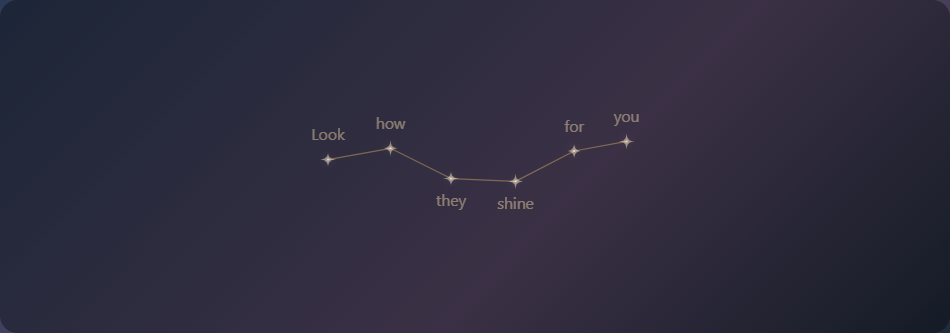
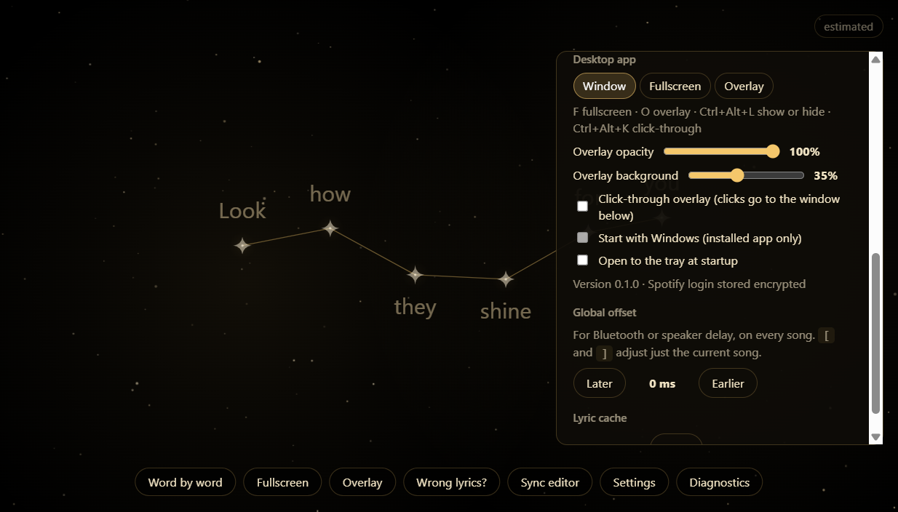

# Installing Lyric Stars

Lyric Stars shows the lyrics of the song playing on Spotify as a constellation, word by word.
It's free, made for friends, and runs only on your PC.

## 1. Download

Get `Lyric-Stars-Setup-<version>.exe` from the Releases page your friend sent you. You don't need Node or anything else.

## 2. Get past the blue "Windows protected your PC" box

The installer isn't signed, because signing costs money every year. Windows SmartScreen warns about every unsigned app it hasn't seen many times before.

1. Click **More info** (the small link under the message).
2. Click **Run anyway**.

If your browser blocks the download first, open the download list and choose **Keep** (in Edge: **…** → **Keep** → **Show more** → **Keep anyway**).

Only do this for a file you got from someone you trust.

## 3. Install

Click **Next** through the installer. It installs just for you, so no admin password is needed. Afterwards you'll find
**Lyric Stars** in the Start menu and on the desktop.

## 4. Connect Spotify

1. Open Lyric Stars and click **Connect Spotify**.
2. Your browser opens the Spotify login page. Log in and accept.
3. The browser tab says **You're logged in**. Close it and go back to the app.

Your login is stored encrypted, so only your Windows account can read it. Settings → **Disconnect Spotify** removes it.

If you'd rather not log in, use Settings → **Lyrics from: Windows media session**. It reads what Spotify, or another player, is
showing in the Windows volume pop-up. Timing is a little less precise this way.

## 5. Pick a style

| Style | How | Good for |
|---|---|---|
| Window | Default | Normal use |
| Fullscreen | `F` | Parties, a TV |
| Overlay | `O` | Lyrics floating over a game or video |

The overlay always stays on top and has a see-through background:

- Drag it by the gold bar at the top, and resize it from the edges.
- In Settings → **Desktop app**, you can set its opacity and how dark its background is.
- **Click-through** sends your clicks to the window underneath. Press **Ctrl+Alt+K** to turn it on or off, since the overlay can't be clicked while it's on.

Each style remembers its own size and place.

## Keys

| Key | Does |
|---|---|
| `F` | Fullscreen on/off |
| `O` | Overlay on/off |
| `M` | Word by word / line by line |
| `S` | Settings |
| `[` `]` | Lyrics earlier/later for this song |
| `Ctrl+Alt+L` | Show or hide Lyric Stars (works from any app) |
| `Ctrl+Alt+K` | Overlay click-through on/off (works from any app) |

## Tray icon

The gold star by the clock gives you:

- Show or Hide
- the three styles
- Click-through
- Start with Windows
- Open to tray
- Check for updates
- Quit

Closing the window quits the app.

## Updates

The app checks the Releases page once a day. When a new version is out, you'll see a message, and the tray and Settings get a
**Download** button. Download it and run the new installer over the old one. Your settings and login are kept.

## Problems

- **"Lyric Stars could not start":** another program is using port 5173, which Lyric Stars needs for the Spotify login. That's often the browser version (`npm start`). Close it and open the app again.
- **Wrong lyrics are never shown.** If a song has no confident match, you'll see "No synced lyrics for this song" instead.
- **Lyrics run early or late:** use Sync editor → Global −/+ for Bluetooth headphones, or `[` / `]` for one song.

## Uninstall

Settings → Apps → Installed apps → Lyric Stars → Uninstall. To also remove the cache, timings and login, delete `%APPDATA%\LyricStars`.

---

## For the person making releases

1. Set `BUILT_IN_CLIENT_ID` (your Spotify app, with redirect URI `http://127.0.0.1:5173/`) and `UPDATE_REPO`
   (`owner/repo`) in `web/config.js`. Bump `version` in `package.json`.
2. Run `npm install` and then `npm run dist`. The installer appears in `dist/Lyric-Stars-Setup-<version>.exe`.
3. On GitHub, create a release tagged `v<version>` and attach the `.exe`. Don't mark it as a pre-release, because the update check skips those.
4. Add your friends' Spotify emails under User Management in the Spotify developer dashboard. Development mode allows 25 users.
